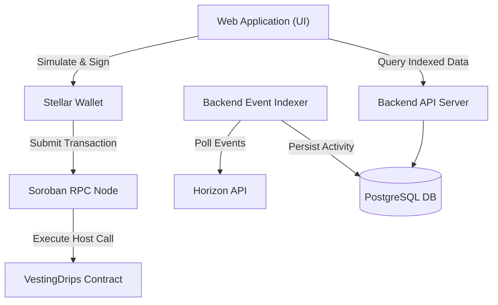
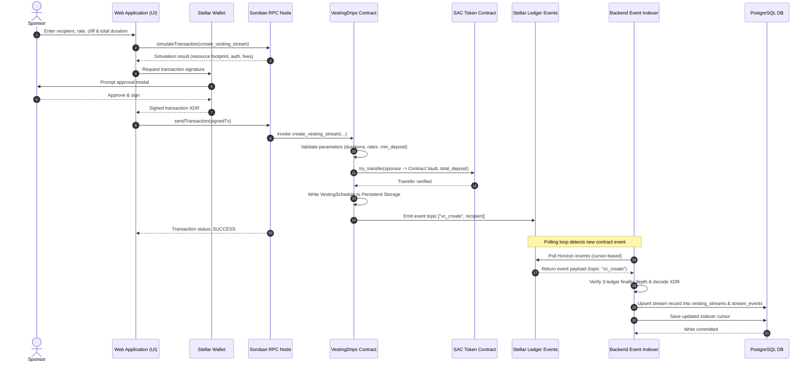
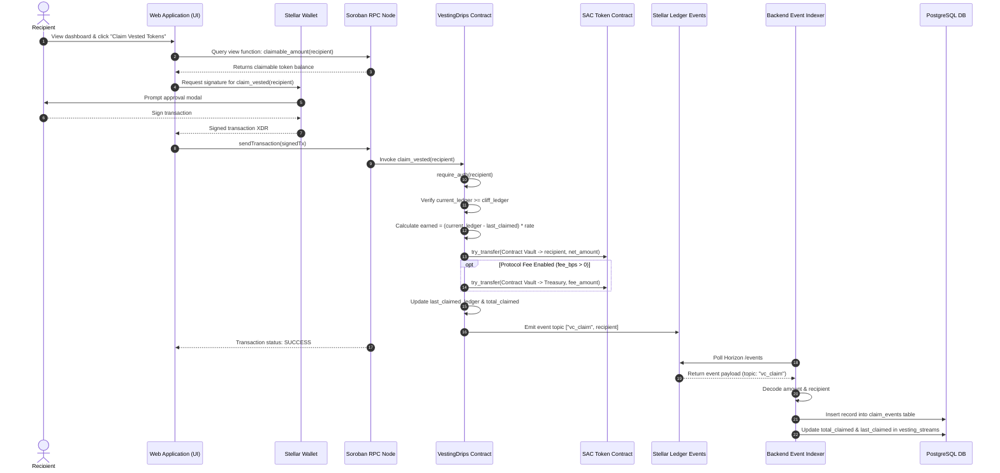
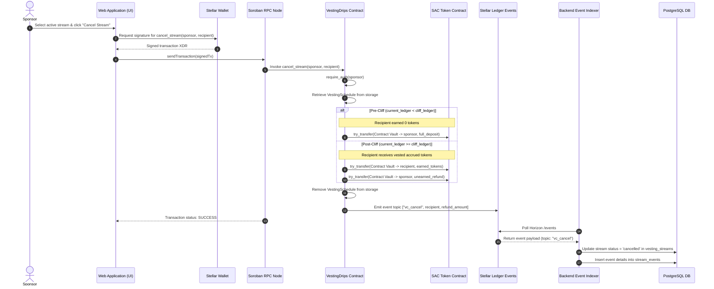
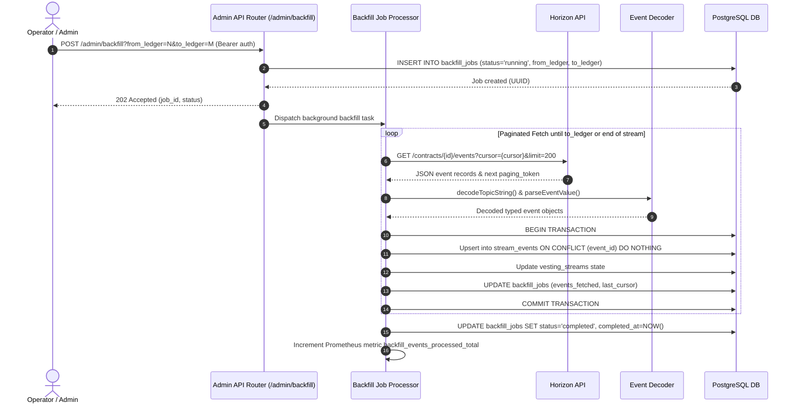
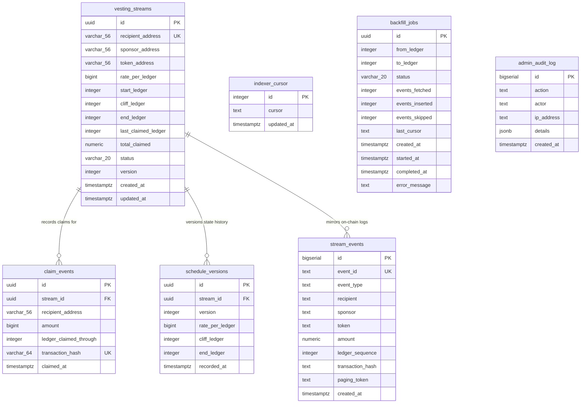
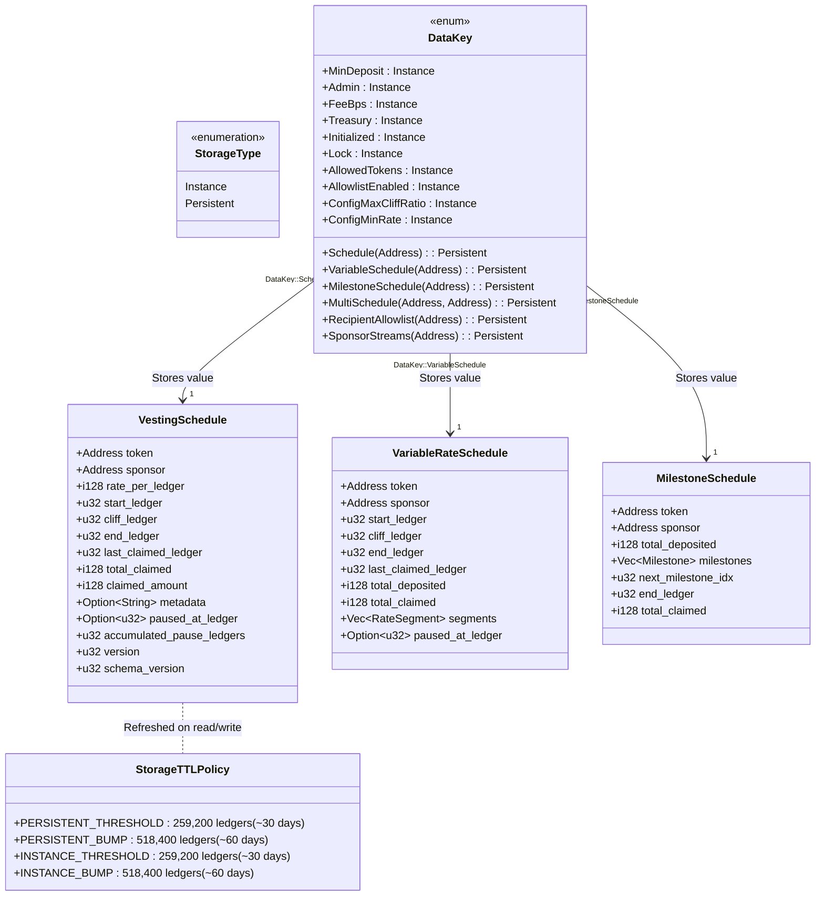

# Full-Stack System Architecture

This document provides a comprehensive architecture overview of the `VestingDrips` platform, illustrating the interaction between the frontend client, backend infrastructure, Horizon / Soroban RPC, and on-chain Soroban smart contracts.

---

## Table of Contents

1. [Top-Level System Overview](#1-top-level-system-overview)
2. [Data Flow & Operation Sequences](#2-data-flow--operation-sequences)
   - [Stream Creation Sequence](#21-stream-creation-sequence)
   - [Claim Vested Tokens Sequence](#22-claim-vested-tokens-sequence)
   - [Cancel Stream Sequence (Pre-Cliff & Post-Cliff Branching)](#23-cancel-stream-sequence)
   - [Event Backfill Sequence](#24-event-backfill-sequence)
3. [Indexer Component Breakdown](#3-indexer-component-breakdown)
4. [Database Entity-Relationship Diagram (ERD)](#4-database-entity-relationship-diagram-erd)
5. [Contract Storage Layout (DataKey & Values)](#5-contract-storage-layout-datakey--values)
6. [References](#6-references)

---

## 1. Top-Level System Overview

The system overview diagram illustrates the end-to-end interactions across client applications, Stellar and Soroban network nodes, and the off-chain indexing and query layer.

### Explanation

- **Web Application (UI)**: Built with Next.js/Vite and TypeScript. Allows sponsors to configure and fund vesting streams, and recipients to track unlocking schedules and claim vested balances. It queries the Backend API Server for fast historical reads and submits live transactions directly to the Stellar network.
- **Stellar Wallet**: User-controlled wallet extensions (e.g., Freighter, Lobstr, Albedo) hold user private keys. The UI prepares unsigned Soroban transaction envelopes and delegates cryptographic signing to the user's wallet.
- **Soroban RPC Node**: Exposes standard RPC methods (`simulateTransaction`, `sendTransaction`, `getTransaction`). Used by the UI to simulate contract executions, estimate required fees and storage footprint, and submit signed transactions.
- **VestingDrips Contract**: Soroban smart contract deployed on the Stellar network. Enforces vesting cliff delays, linear rate releases, protocol fees, safe token custody via Stellar Asset Contracts (SAC), and emits audit events.
- **Horizon API**: Stellar ledger ingest endpoint that exposes ledger metadata, transaction states, and contract event logs.
- **Backend Event Indexer**: A standalone daemon service that continuously polls Horizon for contract events, verifies finality, decodes XDR event payloads, and upserts stream state into PostgreSQL.
- **PostgreSQL DB**: Relational data store maintaining normalized stream records, claim histories, indexer sync cursors, backfill jobs, and audit logs.
- **Backend API Server**: Express/TypeScript server providing REST and GraphQL endpoints for user balances, analytics, and historical event queries, relieving RPC nodes of repetitive read traffic.

---

## 2. Data Flow & Operation Sequences

### 2.1. Stream Creation Sequence

The stream creation flow spans user interface input, wallet approval, contract execution, event emission, and downstream indexing into the database.

### Explanation

1. **Parameters & Simulation**: The sponsor inputs recipient address, token, rate per ledger, cliff duration, and total duration. The frontend simulates the transaction via Soroban RPC to determine storage footprints and fee requirements.
2. **Authorization**: The sponsor approves and signs the transaction in their connected Stellar wallet.
3. **Contract Execution**: The contract executes `create_vesting_stream`, verifies that rate and duration parameters satisfy contract constraints, pulls the upfront deposit from the sponsor to the contract vault using the SAC token client, stores the `VestingSchedule`, and emits the `vc_create` event.
4. **Asynchronous Ingestion**: The backend indexer polls Horizon for new events, decodes the event topics and data, verifies ledger finality (3-ledger depth to protect against reorgs), and writes the stream and event records into PostgreSQL.

---

### 2.2. Claim Vested Tokens Sequence

The claim sequence covers checking claimable balances, signing the claim transaction, transferring unlocked tokens to the recipient, and updating the off-chain indexer.

### Explanation

1. **Pre-Flight Query**: The recipient inspects their claimable balance, which is computed dynamically either by invoking the contract view `claimable_amount(recipient)` or reading cached indexer state.
2. **Execution & Settlement**: The recipient authorizes `claim_vested`. The contract confirms that the cliff has elapsed (`current_ledger >= cliff_ledger`), calculates vested tokens earned between `last_claimed_ledger` and `current_ledger`, deducts protocol fees if applicable, transfers net tokens to the recipient, updates state, and emits `vc_claim`.
3. **Database Synchronization**: The indexer ingests the `vc_claim` event, inserts an immutable record into `claim_events`, updates the stream cumulative claim stats in `vesting_streams`, and invalidates cached view representations.

---

### 2.3. Cancel Stream Sequence

Cancellation allows the original sponsor to terminate an active stream. Unearned tokens are refunded to the sponsor, while any vested tokens earned post-cliff are safely released.

### Explanation

- **Authorization Guard**: Only the original creator (`sponsor`) can cancel a stream. `require_auth(sponsor)` is enforced by the smart contract.
- **Pre-Cliff Branch**: If the current ledger is strictly before `cliff_ledger`, zero tokens have vested to the recipient. 100% of the deposited principal in the contract vault is refunded immediately to the sponsor.
- **Post-Cliff Branch**: If the cliff ledger has passed, the recipient is legally entitled to all linear drip tokens accrued up to the current ledger. The contract transfers the earned amount to the recipient and refunds the remaining unvested tokens to the sponsor.
- **Storage & Indexing**: The schedule is deleted from persistent storage, reducing contract state bloat, and `vc_cancel` is emitted. The indexer transitions the database record status to `'cancelled'` and logs the final refund and payout totals.

---

### 2.4. Event Backfill Sequence

When backend database instances are initialized or recovering from historical downtime, an admin backfill job is dispatched to synchronize historical Horizon events.

### Explanation

1. **Job Initialization**: An operator triggers historical ingestion by supplying ledger bounds (`from_ledger`, `to_ledger`). The admin router validates authorization (`ADMIN_API_KEY`) and inserts a tracking record in `backfill_jobs`.
2. **Batched Pagination**: The processor queries Horizon using cursor-based pagination with a maximum limit of 200 events per page.
3. **Idempotent Upsert**: Decoded event payloads are written into PostgreSQL within database transactions using `ON CONFLICT DO NOTHING` clauses, ensuring safety if re-run over overlapping ranges.
4. **Completion & Metrics**: Job progress is continuously persisted, allowing resumability if interrupted, and updates Prometheus metrics upon completion.

---

## 3. Indexer Component Breakdown

The backend event indexer operates as an autonomous daemon that bridges asynchronous on-chain activity with off-chain persistence and real-time streaming.

```mermaid
flowchart LR
    subgraph PollLoop["1. Poll Loop"]
        Timer["Timer Interval (POLL_INTERVAL_MS)"]
        Fetch["Fetch Horizon Events (limit=200)"]
        Finality["Finality Depth Check (chain tip - ledger >= 3)"]
    end

    subgraph Decoder["2. Event Decoder"]
        TopicDec["Topic String Decoder (decodeTopicString)"]
        ValDec["XDR Value Parser (parseEventValue)"]
        TypeMatch["Event Classifier (vc_create, vc_claim, vc_cancel, vc_drain)"]
    end

    subgraph CursorMgmt["3. Cursor Management"]
        ReadCur["Read Cursor (indexer_cursor table)"]
        TrackPage["Track Last Paging Token"]
        SaveCur["Commit Cursor upon DB Success"]
    end

    subgraph DBWriter["4. DB Writer & PubSub"]
        Tx["DB Transaction (BEGIN ... COMMIT)"]
        Upsert["Upsert Events (ON CONFLICT DO NOTHING)"]
        UpdateStreams["Mutate vesting_streams & claim_events"]
        Invalidate["Cache Invalidation (sorobanViews)"]
        WS["WebSocket Notification (publishEvent)"]
    end

    Timer --> Fetch
    Fetch --> Finality
    Finality --> ReadCur
    Fetch --> TopicDec
    TopicDec --> ValDec
    ValDec --> TypeMatch
    TypeMatch --> Tx
    Tx --> Upsert
    Upsert --> UpdateStreams
    UpdateStreams --> TrackPage
    TrackPage --> SaveCur
    SaveCur --> Invalidate
    Invalidate --> WS
```

### Component Details

- **Poll Loop (`EventIndexer.tick`)**: Executes on a continuous timer loop (`POLL_INTERVAL_MS`, default 6s). Fetches unindexed event batches from Horizon. Enforces a **3-ledger finality depth** requirement (`latestLedger - eventLedger >= 3`) before ingesting records to guarantee safety against short-term ledger rollbacks or chain reorganizations.
- **Event Decoder**: Strips and parses Soroban XDR envelopes. Decodes base64-encoded topic symbols into human-readable event names (`vc_create`, `vc_claim`, `vc_cancel`, `vc_done`, `vc_drain`) and parses corresponding addresses, 128-bit integers, and timestamps.
- **Cursor Management**: Reads the persistent `cursor` token from the `indexer_cursor` table on boot. Ensures that even if the backend crashes mid-batch, the indexer resumes precisely at the last fully committed ledger position without gap formation or missed events.
- **DB Writer & PubSub**: Executes within an atomic PostgreSQL transaction. Deduplicates events by `event_id` and `(transaction_hash, event_index)`. Upon successful commit, it evicts stale read cache entries via `invalidateRecipient` and dispatches live update messages to subscribed frontend clients over WebSocket connections.

---

## 4. Database Entity-Relationship Diagram (ERD)

The relational schema stores contract events, normalized active stream projections, claim histories, and operational telemetry.

### Table Specifications

- **`vesting_streams`**: Represents the current normalized state of each on-chain stream. Keyed by unique `recipient_address`. Provides instant lookup for frontend dashboards without hitting Horizon.
- **`claim_events`**: Immutable append-only log of every individual claim redemption, linking the transferred token amount, ledger sequence, and transaction hash to the parent stream.
- **`schedule_versions`**: Audit trail capturing schedule mutations (such as rate updates, pauses, or schema version bumps) keyed to `stream_id`.
- **`stream_events`**: Comprehensive ledger log storing raw decoded Horizon contract events, used for forensic auditing and event replay.
- **`indexer_cursor`**: Singleton tracking table (id=1) holding the latest Horizon paging token to ensure reliable crash recovery.
- **`backfill_jobs`**: Job status tracking for manual and automated historical event backfills.
- **`admin_audit_log`**: Records administrative operations (such as triggered backfills, fee parameter changes, or system maintenance).

---

## 5. Contract Storage Layout (DataKey & Values)

The Soroban smart contract stores configuration, state locks, and active schedules in `Instance` and `Persistent` storage partitions.

### Storage Map & Value Types

| Storage Kind | DataKey Variant | Stored Value Type | Description |
|---|---|---|---|
| **Persistent** | `Schedule(Address)` | `VestingSchedule` | Standard fixed-rate stream schedule for recipient. |
| **Persistent** | `VariableSchedule(Address)` | `VariableRateSchedule` | Stepped multi-rate vesting schedule for recipient. |
| **Persistent** | `MilestoneSchedule(Address)` | `MilestoneSchedule` | Discrete milestone-based unlocking schedule. |
| **Persistent** | `MultiSchedule(Address, Address)` | `MultiTokenSchedule` | Multi-token stream allocations per recipient and token. |
| **Persistent** | `RecipientAllowlist(Address)` | `bool` | Allowlist verification status for a specific recipient. |
| **Persistent** | `SponsorStreams(Address)` | `Vec<Address>` | List of recipient stream addresses funded by sponsor. |
| **Instance** | `MinDeposit` | `i128` | Minimum initial deposit required to create a stream. |
| **Instance** | `Admin` | `Address` | Privileged administrative account for parameter updates. |
| **Instance** | `FeeBps` | `u32` | Protocol fee in basis points (0–500, max 5%). |
| **Instance** | `Treasury` | `Address` | Protocol fee recipient account. |
| **Instance** | `Initialized` | `bool` | One-time contract initialization flag. |
| **Instance** | `Lock` | `bool` | Reentrancy mutex lock flag during host invocations. |
| **Instance** | `AllowedTokens` | `Vec<Address>` | Approved SAC token contract addresses. |
| **Instance** | `AllowlistEnabled` | `bool` | Toggle governing recipient allowlist enforcement. |
| **Instance** | `ConfigMaxCliffRatio` | `u32` | Max allowed cliff-to-total-duration ratio (bps). |
| **Instance** | `ConfigMinRate` | `i128` | Global minimum rate per ledger threshold. |

### Storage Characteristics & TTL Policies

- **Instance Storage**: Used for shared global configuration, contract metadata, and reentrancy mutexes. Bound to contract lifecycle and bumped whenever administration view or write calls execute.
- **Persistent Storage**: Used for isolated per-user schedules and participant indexes. Each entry is independently keyed, avoiding giant global maps and preventing ledger serialization contention.
- **TTL Extension Strategy**: Every read and write invocation automatically triggers `env.storage().persistent().extend_ttl(key, PERSISTENT_THRESHOLD, PERSISTENT_BUMP)`. The threshold is set to 259,200 ledgers (~30 days) and bumped to 518,400 ledgers (~60 days), guaranteeing active streams never expire while dormant completed streams can safely archive.

---

## 6. References

- [Event Specification](events.md) — ABI schemas, XDR structures, and topic discriminators.
- [Storage Design Specification](storage.md) — Granular storage breakdown and data migration policies.
- [Lifecycle State Machine](flows.md) — Formal stream lifecycle states and error transitions.
- [Soroban Storage Documentation](https://developers.stellar.org/docs/build/guides/storage/choosing-the-right-storage)
