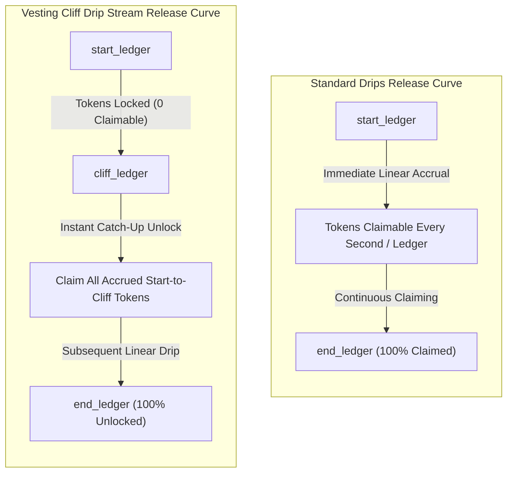
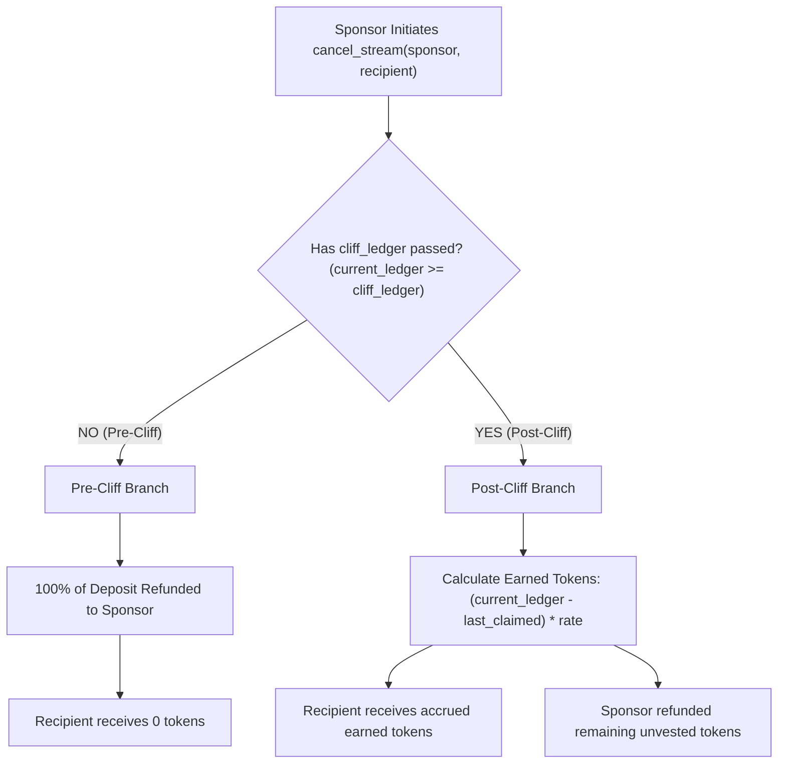

# Vesting Cliff Drip Stream vs Standard Drips

> Unfamiliar with terms like ledger, cliff, SAC, or XDR? See the [glossary](glossary.md).

This document provides a factual, architectural, and behavioural comparison between **vesting-cliff-drip-stream** and standard Drips streaming contracts. It details key functional differences—such as cliff periods, ledger-based catch-up claims, cancellation semantics, and administrative compliance—and provides actionable guidance on when to choose each solution and how to migrate existing streams.

---

## Table of Contents

1. [Feature Comparison Table](#1-feature-comparison-table)
2. [Token Release Curves & Timing Diagram](#2-token-release-curves--timing-diagram)
3. [Cancel Behaviour: Standard Drips vs Vesting Cliff Drip Stream](#3-cancel-behaviour-standard-drips-vs-vesting-cliff-drip-stream)
4. [When to Use Each Contract](#4-when-to-use-each-contract)
5. [Step-by-Step Migration Guide](#5-step-by-step-migration-guide)
6. [Architectural & Compatibility Details](#6-architectural--compatibility-details)
   - [Storage & TTL Model](#storage--ttl-model)
   - [XDR & Parameter Encoding Differences](#xdr--parameter-encoding-differences)
   - [Error Code Mapping](#error-code-mapping)
7. [Rollback Plan](#7-rollback-plan)

---

## 1. Feature Comparison Table

The following table summarizes the primary capabilities of standard Drips protocols compared to the Vesting Cliff Drip Stream Soroban contract:

| Feature | Standard Drips | Vesting Cliff Drip Stream | Architectural & Operational Tradeoffs |
|---|---|---|---|
| **Cliff** | **None** (Tokens release immediately from stream start) | **Mandatory Cliff** (No tokens claimable until `cliff_ledger` is reached) | Standard Drips optimizes for immediate, continuous liquidity. Vesting Cliff enforces contributor retention before any value unlocks. |
| **Instant Catch-up** | **No** (Claims are strictly proportional to elapsed time) | **Yes (Ledger-based Catch-Up Claim)** | At `cliff_ledger`, all tokens accrued between `start_ledger` and `cliff_ledger` unlock simultaneously in a single instant catch-up claim. |
| **Pause / Resume** | **Rare / Unsupported** | **Native On-Chain Support** (`pause_stream` & `resume_stream`) | Sponsors can pause accrual (e.g., sabbatical, dispute). Both `cliff_ledger` and `end_ledger` shift forward dynamically by the paused ledger count upon resumption. |
| **Multi-Stream** | **Supported** (Recipients can have unlimited concurrent streams) | **Controlled Concurrency** (Per-recipient schedule key, optional multi-token allocations) | Standard Drips maintains separate stream IDs. Vesting Cliff keys schedules by recipient address (or multi-token allocation sets), preventing accidental duplicate streams. |
| **Clawback** | **Not Available** | **Stellar SAC Clawback Support** (`clawback_stream`) | Supports regulated institutional assets, security tokens, and stablecoins enabled with the Stellar Asset Contract clawback flag for legal compliance. |
| **Drain** | **Varies / Dependent on custom scripts** | **Dual Drain Protection** (`drain_expired_stream` & `emergency_drain`) | Permissionless recovery for uncollected tokens 1 year after `end_ledger` (`drain_expired_stream`), plus sponsor lost-key recovery (`emergency_drain`). |

---

## 2. Token Release Curves & Timing Diagram

The fundamental differentiator between standard Drips and this contract is the **token unlocking trajectory over time**:

```
Claimable
Tokens
  ▲
  │                                                     [Total Allocation]
100% ──────────────────────────────────────────────────────────●
  │                                                          ╱ │
  │                                                        ╱   │
  │                                                      ╱     │
  │                                 Instant Catch-Up   ╱       │
  │                                      ┌───────────●         │
  │                                      │ (All cliff│         │
  │                                      │  accrual) │         │
  │                                      │           │         │
  │                  Standard Drips ─────┼───────────┼─────────┼───────────►
  │                  (Linear from start) │ ╱         │         │
  │                                      │╱          │         │
  0 ───●─────────────────────────────────┴───────────┼─────────┴───────────► Time
  start_ledger                     cliff_ledger     end_ledger
```

### Visual Workflow Comparison



### Key Differentiators:
1. **Zero Claimable Window**: Between `start_ledger` and `cliff_ledger`, `claimable_amount(recipient)` returns `0`. Calling `claim_vested` during this window halts and returns `CliffNotReached` (code 2).
2. **Ledger-Based Catch-Up Step**: At `cliff_ledger`, the contract does not start from zero rate; it calculates `(cliff_ledger - start_ledger) * rate_per_ledger` and unlocks that entire lump sum in one block.
3. **Linear Post-Cliff Drip**: After the cliff has passed, subsequent tokens drip linearly on a per-ledger basis until `end_ledger` is reached.

---

## 3. Cancel Behaviour: Standard Drips vs Vesting Cliff Drip Stream

Cancellation semantics differ substantially based on whether the cancellation occurs before or after the cliff.



### Granular Comparison:

| Scenario | Standard Drips Behaviour | Vesting Cliff Drip Stream Behaviour |
|---|---|---|
| **Cancellation Prior to Cliff** | **Pro-rata split**: Recipient receives whatever accrued up to that exact timestamp; sponsor receives unaccrued remainder. | **100% Sponsor Refund**: Recipient receives **0 tokens** because the retention lock requirement was not met. The contract returns all deposited tokens to the sponsor. |
| **Cancellation After Cliff** | **Pro-rata split**: Recipient receives accrued tokens up to cancellation time; sponsor receives remainder. | **Earned / Unearned Split**: Recipient receives all accrued tokens (including the cliff catch-up amount and any subsequent linear accrual); sponsor is refunded the remaining unearned allocation. |
| **Cancellation While Paused** | Usually unsupported or results in proportional split up to current time. | **Clamped Split**: Effective accrual is frozen at `paused_at_ledger`. The recipient receives tokens accrued up to the pause point, and unaccrued tokens return to the sponsor. |
| **Authorization** | Often allows contract owner or sponsor to cancel. | **Strict Sponsor Guard**: Only the original creator address (`sponsor`) can authorize `cancel_stream`. There is no administrative backdoor. |

---

## 4. When to Use Each Contract

Choosing between Standard Drips and Vesting Cliff Drip Stream depends on your distribution goals, economic incentives, and compliance requirements:

### Choose Standard Drips When:
- **Real-Time Payroll & Subscriptions**: You are paying contractors, employees, or services on a pay-as-you-go basis where funds should be liquid immediately upon work execution.
- **Continuous Grants & Open Source Tipping**: You want to fund open-source maintainers or creators with continuous micro-streaming without any lockup delays.
- **Micro-Payments**: Use cases where per-second or per-block cash flow is required with zero cliff friction.

### Choose Vesting Cliff Drip Stream When:
- **Core Contributor & Employee Equity Grants**: You need to ensure team members remain committed for an agreed period (e.g. 6 months or 1 year) before any equity or token allocations vest.
- **Investor & Advisory Vesting**: Token generation events (TGE) where investors or advisors have negotiated cliffs (e.g. 12-month cliff followed by 24-month linear vesting).
- **Institutional & Regulated Assets**: You issue tokens subject to legal compliance or transfer restrictions requiring Stellar Asset Contract (SAC) clawback capabilities (`clawback_stream`).
- **DAO Milestones & Performance Bounties**: Distributions tied to operational checkpoints or retention milestones with pause/resume safeguards against scope renegotiations.
- **Abandoned Asset Reclamation**: DAO treasuries requiring guarantees that unclaimed tokens from lost-key or abandoned recipient wallets can be safely recovered after a defined safety delay.

---

## 5. Step-by-Step Migration Guide

This guide walks through migrating an active or planned stream from Standard Drips to Vesting Cliff Drip Stream.

### Step 1: Export Active Streams from Drips
Extract active stream parameters from your Drips subgraph, API, or contract event logs:
- `recipient`: Beneficiary address
- `remaining_balance`: Unstreamed token balance
- `rate`: Tokens per second
- `token`: ERC-20 or asset contract address

### Step 2: Translate Parameters to Stellar & Soroban Units
Three critical conversions must be performed:

1. **Convert Duration from Seconds to Ledgers**:
   Stellar ledgers close every ~5 seconds (approximately **17,280 ledgers per day**):
   $$\text{ledgers} = \frac{\text{seconds}}{5}$$
2. **Scale Rate by `RATE_DECIMALS`**:
   The contract uses fixed-point math (`RATE_DECIMALS = 10_000_000`). A rate of 1 token/ledger must be passed as `10_000_000`.
3. **Configure the Cliff Duration**:
   - If migrating a stream with **immediate release** (matching Drips semantics): set `cliff_duration = 1`.
     *(A cliff of 1 ledger ensures `cliff_ledger == start_ledger + 1`, meaning the stream is claimable almost instantly upon creation).*
   - If introducing a **true retention cliff**: calculate the remaining ledgers until the cliff target date.

### Step 3: Verify Token SAC Address & Allowlist
Ensure the target token is a valid Stellar Asset Contract (SAC) address (`C...`), not a classic Stellar account public key (`G...`):

```bash
# Verify allowed tokens if allowlist is enabled
stellar contract invoke \
  --id $VESTING_CONTRACT \
  --source admin \
  --network testnet \
  -- get_allowed_tokens
```

### Step 4: Execute Creation using Migration Tooling
Use the repository migration script [`scripts/migrate_from_drips.sh`](../scripts/migrate_from_drips.sh):

```bash
export VESTING_CONTRACT="CA..."
export SPONSOR="sponsor-key-name"
export TOKEN="CB..."
export NETWORK="testnet"

# Run batch migration script
./scripts/migrate_from_drips.sh migration-streams.json
```

Sample JSON input payload (`migration-streams.json`):
```json
[
  {
    "recipient": "CDLZFC3SYJYDZT7K67VZ75HPJND63M72NC26P3S5ZZZ4GOHQ2N4KXPA5",
    "sponsor": "GCT46DXL5P5O22M65B7W33GELM5YV62234P7U24XU7OH7QEZW6ZOHK6A",
    "token": "CB64D3G7SM2RTH6JSGG34DDT2S326LN7BI42GGL5O6TV427VMSW4VJZD",
    "rate": 10000000,
    "cliff_duration": 1,
    "total_duration": 518400
  }
]
```

### Step 5: Verify Migrated Streams On-Chain
Query the view functions to ensure schedules are accurately stored:

```bash
stellar contract invoke \
  --id $VESTING_CONTRACT \
  --source default \
  --network testnet \
  -- get_schedule \
  --recipient CDLZFC3SYJYDZT7K67VZ75HPJND63M72NC26P3S5ZZZ4GOHQ2N4KXPA5
```

---

## 6. Architectural & Compatibility Details

### Storage & TTL Model
Unlike EVM Drips which maintains sparse storage mappings, Soroban contracts store schedules in persistent `CONTRACT_DATA` entries. 
- Every read (`get_schedule`) or mutation (`claim_vested`, `cancel_stream`) automatically renews entry TTL to **518,400 ledgers (~60 days)**.
- Integrators should be aware that Soroban view functions (`get_schedule`) execute a storage bump and are not purely side-effect-free at the ledger level.

### XDR & Parameter Encoding Differences

| Parameter | Standard Drips (EVM / Subgraph) | Vesting Cliff Drip Stream (Soroban) |
|---|---|---|
| `rate` | Raw uint256 per second | `i128` scaled by `RATE_DECIMALS` (10,000,000) per ledger |
| `duration` | Unix epoch timestamp / seconds | `u32` ledger count (~5 seconds per ledger) |
| `funding` | Approve-then-pull (allowance) | Full deposit transferred upfront into contract vault |
| `address` | 20-byte EVM address | 32-byte Stellar strkey (`C...` contract or `G...` account) |

### Error Code Mapping

Integrations catching error states must map error codes as defined in `src/error.rs`:

| Failure Condition | Standard Drips | Vesting Cliff Drip Stream | Code |
|---|---|---|---|
| Attempted claim before cliff | N/A | `CliffNotReached` | 2 |
| Claim with zero earned tokens | Reverts with empty error | `NothingToClaim` | 7 |
| Non-existent stream | Reverts `StreamNotFound` | `ScheduleNotFound` | 1 |
| Duplicate stream for recipient | Allowed (generates new ID) | `ScheduleAlreadyExists` | 6 |
| Total duration <= cliff duration | N/A | `InvalidDuration` | 3 |
| Rate <= 0 | Reverts `InvalidRate` | `InvalidRate` | 4 |
| Sponsor == Recipient | Allowed | `InvalidRecipient` | 11 |

---

## 7. Rollback Plan

If an issue occurs during migration (e.g. rate calculation mistake or incorrect recipient address), the sponsor can cancel the newly created stream before any tokens are claimed:

```bash
# Execute rollback via migration-rollback helper
export VESTING_CONTRACT="CA..."
export SPONSOR="sponsor-key-name"
export NETWORK="testnet"

./examples/migration-rollback.sh migration-streams.json
```

Because pre-cliff cancellation triggers a **100% refund** of all vault tokens to the sponsor, funds are immediately restored to the sponsor's account without leakage.
