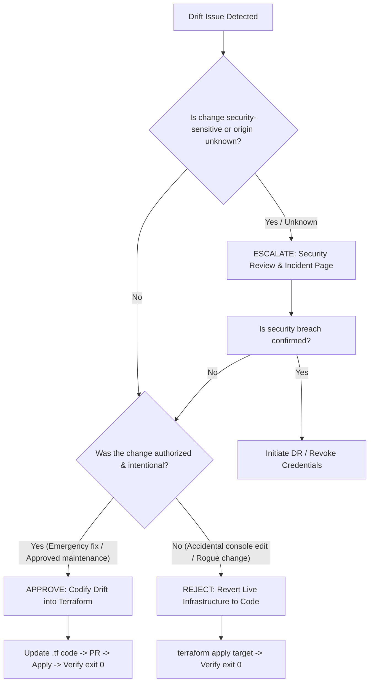

# Runbook: Terraform Drift Reconciliation

**Workflow Reference:** [.github/workflows/drift-detection.yml](../../.github/workflows/drift-detection.yml)  
**Alert Channels:** `#ops`, `#incidents` (Slack), PagerDuty for critical alerts  
**Target Environments:** `staging`, `production`

---

## 1. Overview & SLAs

Infrastructure drift occurs when the actual state of AWS resources diverges from the authoritative configuration defined in Terraform (e.g., manual console edits, hotfixes applied during outages, or script modifications). Unmanaged drift causes state inconsistency, deployment failures, and security blindspots.

The scheduled drift detection workflow runs daily at 02:00 UTC (and on-demand via `workflow_dispatch`) using [.github/workflows/drift-detection.yml](../../.github/workflows/drift-detection.yml). When drift is detected, it opens or updates a workflow-managed GitHub issue labeled `infrastructure` and `drift`, and sends an alert to `#ops`.

### Response SLAs

Drift response priority is governed by resource criticality:

| Severity | Resource Type Examples | Triage SLA | Resolution SLA | Escalation Target |
|:---|:---|:---|:---|:---|
| **Critical** | IAM roles/policies, Security Groups (ingress/egress), KMS key policies, S3 bucket public access | **15 minutes** | **4 hours** | Security Lead & Incident Commander |
| **High** | ECS service definitions/task definitions, RDS instances/cluster configs, VPC routing/subnets | **1 hour** | **8 hours** | DevOps Lead |
| **Medium / Low** | CloudWatch log retention, resource tags, alarms, non-critical parameter tweaks | **4 hours** | **24 hours (1 business day)** | Primary On-Call |

---

## 2. Reading the Terraform Plan Excerpt in Drift Issues

The drift detection issue body contains metadata, execution timestamp, and a sanitized, truncated excerpt of `terraform plan`. The full output is uploaded as a 90-day CI artifact named `drift-plan-<environment>-<run-id>`.

### Plan Action Symbols

| Symbol | Action | Meaning & Impact |
|:---|:---|:---|
| `~` | **Update in-place** | Resource exists in both state and AWS, but one or more attributes differ. Terraform will modify the resource in-place. |
| `+` | **Create** | Resource exists in code but is missing in AWS, OR Terraform wants to restore a deleted resource. |
| `-` | **Destroy** | Resource exists in AWS/state but was removed from code, OR an untracked resource must be removed. |
| `-/+` | **Replace (destroy then create)** | An attribute change requires recreating the resource (causes downtime if not blue/green). |
| `<=` | **Read** | Data source will be read. |

### Reading the Diff Lines

```terraform
# module.compute.aws_ecs_service.backend will be updated in-place
~ resource "aws_ecs_service" "backend" {
      id                                 = "arn:aws:ecs:us-east-1:123456789012:service/prod-vesting/vesting-backend"
      name                               = "vesting-backend"
    ~ desired_count                      = 4 -> 2
      tags                               = {}
      # (14 unchanged attributes hidden)
  }
```
- Line starting with `~ desired_count = 4 -> 2`: The live AWS service has `desired_count = 4`, but Terraform configuration specifies `desired_count = 2`. Running `terraform apply` will reduce the count to 2.
- Attribute lines prefixed with `-`: Value will be removed.
- Attribute lines prefixed with `+`: Value will be added.

### Accessing the Full Artifact Plan

When the plan excerpt in the issue is truncated (indicated by `[... truncated ...]`), retrieve the full plan artifact via the GitHub CLI:

```bash
# Replace <run-id> and <environment> with the values from the GitHub issue
gh run download <run-id> --name drift-plan-<environment>-<run-id>
cat drift-plan-<environment>-<run-id>/drift-plan.txt
```

---

## 3. Drift Evaluation Decision Tree

When evaluating a drift issue, follow this decision matrix:



### Classification Criteria:
1. **Approve (Intentional Drift):**
   - Performed during an active incident mitigation (documented in incident ticket).
   - Temporary autoscaling adjustment that needs to become permanent.
   - Action: Update Terraform code to match reality, open PR, and merge.
2. **Reject (Unauthorized Drift):**
   - Accidental modification via AWS Management Console or ad-hoc CLI.
   - Out-of-spec manual configuration that violates infrastructure standards.
   - Action: Revert live state back to the Terraform configuration baseline.
3. **Escalate (Unknown or Security Drift):**
   - Modified IAM policies, security groups with open CIDRs (`0.0.0.0/0`), KMS alterations.
   - Modifications made by unrecognized IAM users, roles, or foreign IP addresses.
   - Action: Page the Security Lead immediately, lock down credentials, and trigger incident response.

---

## 4. Step-by-Step: Applying Approved Drift (Codification)

Use this procedure when the live change is intentional and should be retained in code.

### Step 4.1: Identify the Author and Context via CloudTrail
Before codifying, verify who made the change and why:
```bash
aws cloudtrail lookup-events \
  --lookup-attributes AttributeKey=ResourceName,AttributeValue=<resource-id> \
  --start-time "$(date -u -d '48 hours ago' '+%Y-%m-%dT%H:%M:%SZ')" \
  --query 'Events[*].{Time:EventTime,User:Username,Event:EventName,AccessKeyId:AccessKeyId}' \
  --output table
```

### Step 4.2: Update Terraform Source Code
1. Checkout a new branch from `main`:
   ```bash
   git checkout -b fix/terraform-codify-<resource>-drift
   ```
2. Edit the corresponding `.tf` file in `terraform/` or `terraform/modules/` to reflect the desired state.
3. Example: if `desired_count` was scaled to 4 in production, update `terraform/envs/production.tfvars` or `modules/compute/main.tf`:
   ```hcl
   desired_count = 4
   ```

### Step 4.3: Verify Plan Convergence Locally
Run `terraform plan` to confirm that the diff is now clean:
```bash
cd terraform
export TF_DATA_DIR="$PWD/.terraform/production"
terraform init -input=false -backend-config=envs/production.backend.hcl

terraform plan \
  -lock-timeout=5m \
  -var-file=envs/production.tfvars \
  -detailed-exitcode
```
- **Exit Code 0:** No changes needed. Live infrastructure matches updated Terraform configuration.
- **Exit Code 2:** Changes still present. Refine code until diff is 0.

### Step 4.4: Submit PR and Deploy
1. Commit the change referencing the drift issue:
   ```bash
   git commit -m "fix(terraform): codify manual update to <resource> (closes #<issue-id>)"
   ```
2. Push branch, submit PR, and obtain required peer approvals.
3. Merge PR to `main` to trigger the deployment pipeline.

---

## 5. Step-by-Step: Reverting Unauthorized Drift

Use this procedure when the live change is unauthorized or accidental and must be reverted to match Terraform.

### Method A: Targeted Terraform Apply (Recommended)
Target the drifted resource directly to avoid touching other components:

```bash
cd terraform
export TF_DATA_DIR="$PWD/.terraform/production"
terraform init -input=false -backend-config=envs/production.backend.hcl

# 1. Generate targeted execution plan
terraform plan \
  -target=module.compute.aws_ecs_service.backend \
  -var-file=envs/production.tfvars \
  -lock-timeout=5m \
  -out=revert.tfplan

# 2. Review the plan to ensure only unauthorized changes are reverted
terraform show revert.tfplan

# 3. Apply the plan to revert live infrastructure
terraform apply -lock-timeout=5m revert.tfplan
```

### Method B: Immediate AWS CLI Reversion (Emergency Mitigation)
If an unauthorized change introduces an immediate security vulnerability (e.g. security group rule opened to `0.0.0.0/0`), revert it immediately via AWS CLI:

```bash
# Revoke unauthorized ingress rule immediately
aws ec2 revoke-security-group-ingress \
  --group-id sg-0123456789abcdef0 \
  --protocol tcp \
  --port 22 \
  --cidr 0.0.0.0/0

# Refresh Terraform state to confirm alignment
terraform refresh -var-file=envs/production.tfvars
```

### Step 5.1: Confirm Infrastructure Match
Verify that `terraform plan` reports clean state:
```bash
terraform plan -var-file=envs/production.tfvars -detailed-exitcode
```

---

## 6. Closing Drift Issues: Automated vs. Manual

The drift detection workflow ([.github/workflows/drift-detection.yml](../../.github/workflows/drift-detection.yml)) manages drift tracking issues automatically, but human intervention is sometimes required.

### 6.1 Automated Workflow Closure
- **How it works:** The automated workflow marks its issue with the hidden marker:
  ```html
  <!-- terraform-drift-workflow:managed -->
  ```
- While drift exists, the workflow updates this single issue on every scheduled run.
- When the drift is resolved and a clean plan (`exit 0`) is detected, the workflow automatically posts a resolution comment and closes the issue:
  > *"Terraform plan reports no changes. The infrastructure is in sync with configuration. Closing this workflow-managed drift issue."*
- **Fast-track trigger:** After applying a fix, you can immediately trigger the workflow via GitHub Actions (`workflow_dispatch`) on `drift-detection.yml` to close the issue automatically.

### 6.2 Manual Issue Closure
Manual closure is required when:
- The drift issue was opened manually by an engineer (does not carry the managed marker).
- The issue was determined to be a false positive (e.g., ephemeral AWS provider read-time attribute).
- The drift was reconciled manually during an incident and the issue needs immediate sign-off.

**Manual Closure Protocol:**
1. Verify the plan is clean:
   ```bash
   terraform plan -var-file=envs/production.tfvars -detailed-exitcode
   # Must exit with code 0 ("No changes. Your infrastructure matches the configuration.")
   ```
2. Post a resolution summary comment in the GitHub issue:
   ```markdown
   ### Drift Resolution Summary
   - **Root Cause:** <Accidental console edit / Emergency fix / etc.>
   - **Resolution Action:** <Reverted live AWS state / Codified into terraform via PR #XYZ>
   - **Verification:** `terraform plan` exit code 0 verified on commit `<sha>`
   - **Operator:** @<github-username>
   ```
3. Apply the label `resolved` and close the issue as completed.
4. Notify the team in `#ops` with the resolution link.

---

## 7. Escalation Contacts & Commands Appendix

### Escalation Matrix

| Role | Contact Channel | Trigger Condition |
|:---|:---|:---|
| **Incident Commander** | PagerDuty `vesting-ic` | Unidentified drift in production lasting > 2 hours |
| **Security Lead** | PagerDuty `vesting-security` | Any drift on IAM, KMS, Security Groups, or Secrets |
| **DevOps On-Call** | `#ops` / PagerDuty | State lock conflicts, backend S3 state corruption |

### Useful Commands Reference

```bash
# Check current state of a drifted resource
terraform state show module.compute.aws_ecs_service.backend

# List all tracked resources in state
terraform state list

# Inspect state file without locks
terraform state pull > /tmp/live-state.json

# Identify who made recent API calls to a specific resource
aws cloudtrail lookup-events \
  --lookup-attributes AttributeKey=ResourceName,AttributeValue=<resource-arn> \
  --max-results 10 \
  --query 'Events[*].[EventTime,Username,EventName,SourceIPAddress]'
```
