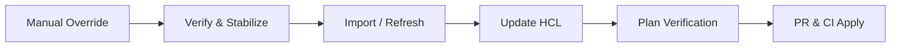

# Runbook: Emergency Infrastructure Override

This runbook defines the mandatory procedure for making emergency manual changes to AWS infrastructure outside of the standard Terraform CI/CD workflow, along with the required post-hoc Terraform update process.

> [!CAUTION]
> **Emergency overrides are rare exceptions, not a standard operational workflow.**
> Bypassing Terraform creates infrastructure drift, security blind spots, and risk of catastrophic rollback on subsequent automated applies. Overrides may only be executed during verified high-severity production emergencies.

---

## 1. When to Use Emergency Override

An emergency override may **only** be invoked when all of the following criteria are satisfied:

1. **Active High-Severity Production Incident:** An active Sev-1 or Sev-2 incident has been officially declared in the `#incidents` Slack channel.
2. **Impending or Active Service Degradation:** Customer-facing services, data integrity, or core protocol functions are severely impacted or at immediate risk of failure.
3. **Terraform Pipeline Infeasible:** The normal GitOps / Terraform PR workflow (`feature branch -> PR -> CI plan -> review -> merge -> apply`) is too slow to mitigate the incident in time (e.g., pipeline exceeds 15 minutes or CI runner is degraded).
4. **Targeted and Understood Action:** The exact manual remediation action is understood and carries lower immediate risk than leaving the incident unmitigated.

If these conditions are not met, you **must** use the standard Terraform pull request workflow.

---

## 2. Pre-Action Checklist

Before performing any manual modification in AWS, complete every item in this checklist:

- [ ] **Dual Engineering Approval (N=2):** Approval must be explicitly granted by at least two senior engineers:
  - Incident Commander (IC)
  - Infrastructure Lead or Secondary Senior Engineer
- [ ] **Document Change Intent:** Post a structured notice in the `#incidents` Slack thread declaring:
  - Exact target resource(s) (ARN, ID, or name)
  - Planned modification / parameters
  - Operational justification
  - Names of both approving engineers
- [ ] **Identify Drift Issue:** Identify or reference the active workflow-managed drift tracking issue in GitHub (`[Drift] <environment> infrastructure drift detected`).
- [ ] **Verify Live Resource State:** Inspect current resource configuration prior to modification to ensure baseline state is captured.
- [ ] **Assume Break-Glass IAM Role:** Assume the dedicated break-glass role with session auditing enabled.

### Pre-Action Notice Template (Slack `#incidents`)

```text
🚨 EMERGENCY OVERRIDE DECLARATION
Incident: #<incident-number>
Target Environment: <production | staging>
Resource(s): <e.g., aws_ecs_service.backend (vesting-backend)>
Proposed Action: <e.g., scale desired tasks from 2 to 6>
Justification: <traffic spike causing CPU exhaustion and RPC timeouts>
Approved by: @<Incident-Commander> and @<Infra-Lead>
Operator: @<your-handle>
Timestamp: <YYYY-MM-DD HH:MM UTC>
```

---

## 3. Assuming Break-Glass Role

The emergency override role (`vesting-emergency-override`) provides temporary elevated permissions. All actions are audited via AWS CloudTrail.

```bash
# Obtain temporary STS break-glass credentials (valid for 1 hour)
aws sts assume-role \
  --role-arn arn:aws:iam::<ACCOUNT_ID>:role/vesting-emergency-override \
  --role-session-name "emergency-override-$(date +%Y%m%dT%H%M)" \
  --duration-seconds 3600 \
  --query 'Credentials.[AccessKeyId,SecretAccessKey,SessionToken]' \
  --output text > /tmp/creds.txt

export AWS_ACCESS_KEY_ID=$(awk '{print $1}' /tmp/creds.txt)
export AWS_SECRET_ACCESS_KEY=$(awk '{print $2}' /tmp/creds.txt)
export AWS_SESSION_TOKEN=$(awk '{print $3}' /tmp/creds.txt)
rm -f /tmp/creds.txt

# Verify caller identity
aws sts get-caller-identity
```

---

## 4. Manual Change Execution (Common Emergency Scenarios)

### Scenario A: Scaling ECS Service Tasks (Traffic Spike / Task Starvation)

#### AWS CLI
```bash
# Update desired count immediately
aws ecs update-service \
  --cluster vesting-prod \
  --service vesting-backend \
  --desired-count 6

# Monitor rollout until stable
aws ecs wait services-stable \
  --cluster vesting-prod \
  --services vesting-backend
```

#### AWS Console
1. Navigate to **Amazon ECS** > **Clusters** > `vesting-prod`.
2. Select the **Services** tab and click `vesting-backend`.
3. Click **Update service**.
4. Under **Desired tasks**, modify the count to the emergency target (e.g., `6`).
5. Click **Update** and observe task deployments in the **Tasks** tab.

---

### Scenario B: Modifying Security Group Rules (Blocking Malicious IP or Allowing Emergency Access)

#### AWS CLI
```bash
# Block / allow specific CIDR on backend security group
aws ec2 authorize-security-group-ingress \
  --group-id sg-0123456789abcdef0 \
  --protocol tcp \
  --port 443 \
  --cidr 198.51.100.4/32 \
  --description "Emergency hotfix ingress incident-42"

# To revoke an offending rule:
aws ec2 revoke-security-group-ingress \
  --group-id sg-0123456789abcdef0 \
  --protocol tcp \
  --port 443 \
  --cidr 203.0.113.0/24
```

#### AWS Console
1. Navigate to **EC2** > **Network & Security** > **Security Groups**.
2. Select the target security group (e.g., `vesting-prod-backend-sg`).
3. Click **Actions** > **Edit inbound rules**.
4. Add or remove the required rule with description `Emergency hotfix incident-<id>`.
5. Click **Save rules**.

---

### Scenario C: Modifying RDS Instance Class or Emergency Reboot

#### AWS CLI
```bash
# Emergency scaling of RDS instance class
aws rds modify-db-instance \
  --db-instance-identifier vesting-prod-db \
  --db-instance-class db.r6g.xlarge \
  --apply-immediately

# Emergency reboot with failover to Multi-AZ standby
aws rds reboot-db-instance \
  --db-instance-identifier vesting-prod-db \
  --force-failover
```

#### AWS Console
1. Navigate to **Amazon RDS** > **Databases**.
2. Select `vesting-prod-db`.
3. For failover reboot: Click **Actions** > **Reboot**, check **Reboot With Failover?**, and confirm.
4. For instance sizing: Click **Modify**, change **DB instance class**, select **Apply immediately**, and click **Modify DB instance**.

---

### Scenario D: Rotating Compromised Secrets in AWS Secrets Manager

#### AWS CLI
```bash
# Update secret string immediately
aws secretsmanager put-secret-value \
  --secret-id "vesting/prod/backend" \
  --secret-string '{"DATABASE_URL":"...","JWT_SECRET":"..."}' \
  --version-stage "AWSCURRENT"
```

#### AWS Console
1. Navigate to **AWS Secrets Manager** > **Secrets**.
2. Select `vesting/prod/backend`.
3. Scroll to **Secret value** and click **Retrieve secret value** > **Edit**.
4. Update the compromised keys and click **Save**.
5. Restart ECS tasks to pick up the updated secret.

---

## 5. Post-Hoc Terraform Update Procedure (Mandatory within 24 Hours)

Any manual infrastructure override introduces **drift**. You must reconcile this drift in Terraform within 24 hours of incident mitigation.



### Step 1: Create Reconciliation Branch
```bash
git checkout main
git pull upstream main
git checkout -b fix/codify-emergency-override-incident-<id>
```

### Step 2: Import or Refresh Changed Resources
- If a resource was modified in place:
  ```bash
  cd terraform
  terraform plan -refresh-only -var-file=envs/production.tfvars
  ```
- If a new resource was created manually out-of-band:
  ```bash
  terraform import -var-file=envs/production.tfvars <terraform_resource_address> <aws_resource_id>
  # Example:
  # terraform import -var-file=envs/production.tfvars aws_security_group_rule.emergency_ingress sgr-0123456789
  ```

### Step 3: Update HCL Code
Update the Terraform configurations (`terraform/*.tf` or `terraform/modules/**/*.tf`) and variable files (`envs/production.tfvars`) so the code precisely reflects the live infrastructure state:

```hcl
# Example update in terraform/modules/compute/main.tf
resource "aws_ecs_service" "backend" {
  # ...
  # Codified from Emergency Override incident #42 on 2026-10-21
  desired_count = 6
}
```

### Step 4: Verify Plan Convergence
Run `terraform plan` against the target environment. The plan output must report **no unexpected replacements or deletions**:
```bash
terraform plan -var-file=envs/production.tfvars -detailed-exitcode
# Target: exit code 0 (No changes) or exit code 2 showing only intended codification
```

### Step 5: Submit PR and Apply via CI/CD
1. Submit pull request titled:
   `fix(terraform): codify emergency override from incident #<id>`
2. Reference the incident Slack thread, CloudTrail event, and drift detection issue.
3. Once approved and merged, allow the standard CD pipeline to run `terraform apply`.

---

## 6. Audit Trail & Drift Issue Logging Requirements

Every emergency override must be documented to maintain strict regulatory compliance and operational visibility:

| Requirement | Destination | SLA | Responsible Party |
|---|---|---|---|
| Pre-action notification | Slack `#incidents` | Before execution | Operator |
| Dual engineering approval | Slack `#incidents` | Before execution | IC & Infra Lead |
| CloudTrail event capture | AWS CloudTrail (`sts:AssumeRole`, resource APIs) | Automatic (Immediate) | AWS System |
| Drift Issue Log Comment | Active GitHub Drift Issue (`infrastructure` + `drift`) | Within 2 hours | Operator |
| Post-hoc Codification PR | GitHub repository | Within 24 hours | On-call Engineer |
| Incident Post-Mortem | `docs/runbooks/` or incident archive | Within 48 hours | Incident Commander |

### Logging in the Workflow-Managed Drift Issue
Because emergency overrides alter live infrastructure, the daily drift detection workflow will detect the difference. The operator **must** post a comment on the open workflow-managed drift issue (e.g. `[Drift] production infrastructure drift detected`):

```markdown
### 🚨 Emergency Infrastructure Override Logged
- **Incident Reference:** #<incident-id>
- **Environment:** production
- **Affected Resource(s):** `aws_ecs_service.backend`
- **Change Details:** Temporarily increased desired tasks from 2 to 6 to mitigate memory starvation.
- **Approvers:** @IncidentCommander, @InfraLead
- **Executed By:** @Operator
- **CloudTrail Event ID:** `c948df92-62b1-4d33-a612-4f0148123abc`
- **Reconciliation PR:** PR #<PR_number> (In progress, ETA < 24h)
```

---

## 7. Consequences of Omitting Post-Hoc Updates

Failing to complete the post-hoc Terraform reconciliation leads to serious failure modes:

1. **Drift Detection Alarms:**
   The automated drift detection workflow runs every day at `02:00 UTC`. Any uncodified manual change will be flagged as drift, creating/updating high-priority drift issues and alerting `#ops` in Slack.
2. **Accidental Reversion / Outage Recurrence:**
   When another engineer merges an unrelated change, the CI/CD pipeline runs `terraform apply`. Terraform will identify the uncodified live resource as out-of-spec and **revert it back to the old HCL definition**, instantly re-triggering the outage!
3. **State Corruption & Resource Destruction:**
   Out-of-band resource modifications can lead to conflicting resource dependencies, causing subsequent plans to propose destructive resource recreation (`destroy and re-create`).
4. **Audit and Compliance Violations:**
   Untracked manual changes violate SOC 2 and SBOM compliance policies, leaving no auditable version-controlled trail for infrastructure modifications.
