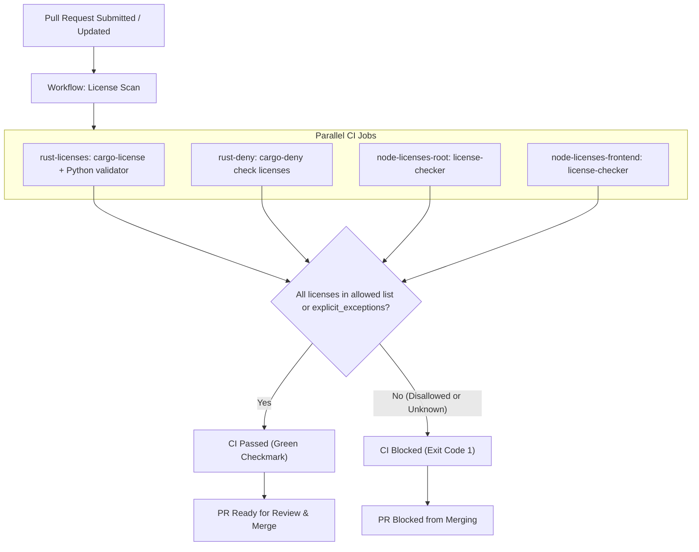

# Software Bill of Materials (SBOM) & License Compliance Policy

This document defines the Software Bill of Materials (SBOM) policy, approved and blocked open-source software licenses, instructions for adding new dependencies and updating SBOM artifacts, tooling workflows, and the Continuous Integration (CI) enforcement process for `vesting-cliff-drip-stream`.

---

## Table of Contents

1. [Overview & Purpose](#1-overview--purpose)
2. [Allowed Licenses](#2-allowed-licenses)
3. [Blocked Licenses](#3-blocked-licenses)
4. [SBOM Generation Tooling](#4-sbom-generation-tooling)
   - [SPDX 2.3 Specification](#spdx-23-specification)
   - [Generating with `cargo sbom`](#generating-with-cargo-sbom)
   - [Generating with `syft`](#generating-with-syft)
5. [Instructions: Adding a New Dependency & Updating the SBOM](#5-instructions-adding-a-new-dependency--updating-the-sbom)
6. [CI Enforcement Process](#6-ci-enforcement-process)
7. [Exception Request Process](#7-exception-request-process)
8. [References](#8-references)

---

## 1. Overview & Purpose

A Software Bill of Materials (SBOM) is an authoritative, machine-readable inventory of all software packages, dependencies, components, and associated licenses comprising the application and its smart contracts. 

To maintain cryptographic supply chain integrity, protect downstream integrators against restrictive copyleft obligations, and comply with modern enterprise security standards (such as US Executive Order 14028), every release of this repository produces an official SBOM adhering to the **SPDX 2.3 JSON** format (`sbom.spdx.json`).

The authoritative machine-readable license policy is maintained at [`.license-policy.json`](../.license-policy.json) and mirrored in [`deny.toml`](../deny.toml).

---

## 2. Allowed Licenses

Only permissive open-source licenses that grant unencumbered rights to link, compile, redistribute, and execute the compiled WebAssembly (WASM) contract and accompanying TypeScript/JavaScript services are permitted.

The following licenses are approved for direct and transitive dependencies:

| License Name | SPDX Identifier | Permitted Scope |
|---|---|---|
| **MIT License** | `MIT` | Runtime, Contract & Dev |
| **Apache License 2.0** | `Apache-2.0` | Runtime, Contract & Dev |
| **BSD 2-Clause "Simplified"** | `BSD-2-Clause` | Runtime, Contract & Dev |
| **BSD 3-Clause "New" or "Revised"** | `BSD-3-Clause` | Runtime, Contract & Dev |
| **ISC License** | `ISC` | Runtime, Contract & Dev |
| **The Unlicense** | `Unlicense` | Runtime, Contract & Dev |

### Additional Permissive Variants

The policy also permits compatible permissive variants explicitly listed in `.license-policy.json`:
- `MIT-0` (MIT No Attribution)
- `Apache-2.0 WITH LLVM-exception`
- `0BSD` (Zero-Clause BSD)
- `BSD-4-Clause`
- `CC0-1.0` (Creative Commons Zero 1.0 Universal)
- `BlueOak-1.0.0`
- `Zlib`
- `Unicode-DFS-2016` & `Unicode-3.0`

### Dual-Licensed Dependencies

For dual-licensed dependencies (e.g., `MIT OR Apache-2.0` or `Apache-2.0 OR BSD-3-Clause`):
- **SPDX OR Expressions**: Compliant if **at least one** branch resolves to an allowed license.
- **SPDX AND Expressions**: Compliant only if **every** component license resolves to an allowed license.

---

## 3. Blocked Licenses

Strong copyleft, weak copyleft, source-available, and restrictive commercial licenses are strictly **prohibited**. Including these licenses could impose legal requirements to release proprietary application code or create viral licensing obligations for downstream Stellar ecosystem consumers.

The following license families are blocked:

| Blocked License Family | SPDX Identifier(s) | Reason for Exclusion |
|---|---|---|
| **GNU General Public License (GPL)** | `GPL-2.0`, `GPL-2.0-only`, `GPL-2.0-or-later`, `GPL-3.0`, `GPL-3.0-only`, `GPL-3.0-or-later` | Strong copyleft; viral source disclosure obligations. |
| **GNU Lesser General Public License (LGPL)** | `LGPL-2.0`, `LGPL-2.0-only`, `LGPL-2.0-or-later`, `LGPL-2.1`, `LGPL-2.1-only`, `LGPL-2.1-or-later`, `LGPL-3.0`, `LGPL-3.0-only`, `LGPL-3.0-or-later` | Dynamic linking requirement incompatible with static WASM binaries. |
| **GNU Affero General Public License (AGPL)** | `AGPL-3.0`, `AGPL-3.0-only`, `AGPL-3.0-or-later` | Network-triggered copyleft requirements. |
| **Server Side Public License (SSPL)** | `SSPL-1.0` | Non-OSI restrictive source-available terms. |
| **Commons Clause** | `Commons Clause` | Commercial use restrictions; incompatible with open-source distribution. |
| **Business Source License** | `BUSL-1.1` | Time-delayed source-available license with production restrictions. |
| **Proprietary / Closed Source** | `Proprietary` | Unverified licensing terms and redistribution limitations. |

---

## 4. SBOM Generation Tooling

### SPDX 2.3 Specification

The primary SBOM artifact is generated as **SPDX 2.3 JSON** (`sbom.spdx.json`). It catalogues:
- Root package metadata (name, version, repository URL, checksums).
- All direct and transitive crate and npm dependencies.
- Standardized SPDX license identifiers for each package.
- Package supplier/author details and download locations.
- Dependency relationship graphs (`DEPENDS_ON`, `CONTAINS`).

Release builds publish `sbom.spdx.json` as an official GitHub Release asset alongside scoped variants:
- `sbom.spdx.json`: Consolidated project SBOM.
- `sbom-rust.spdx.json`: Rust crates defined in `Cargo.lock`.
- `sbom-node-root.spdx.json`: Root Node.js tooling dependencies.
- `sbom-node-frontend.spdx.json`: Frontend application dependencies.

### Generating with `cargo sbom`

For Rust dependencies, `cargo-sbom` produces an SPDX 2.3 JSON document directly from the resolved `Cargo.lock`:

```bash
# Install cargo-sbom
cargo install cargo-sbom --locked

# Generate SPDX 2.3 JSON SBOM from Cargo.lock
cargo sbom --output-format spdx_json_2_3 > sbom.spdx.json
```

To validate that the generated document is valid JSON and well-formed:

```bash
jq -e . spdx.json > /dev/null && echo "SPDX JSON is valid"
```

### Generating with `syft`

[Syft](https://github.com/anchore/syft) is the primary multi-ecosystem SBOM generator used by CI workflows. It analyzes filesystem trees, `Cargo.lock`, and `package-lock.json` manifests:

```bash
# Install syft CLI
curl -sSfL https://raw.githubusercontent.com/anchore/syft/main/install.sh | sh -s -- -b /usr/local/bin

# Generate consolidated SPDX 2.3 JSON SBOM
syft dir:. -o spdx-json=sbom.spdx.json

# Generate scoped Rust-only SBOM from Cargo.lock
syft file:Cargo.lock -o spdx-json=sbom-rust.spdx.json

# Generate scoped Node.js frontend SBOM
syft dir:./frontend -o spdx-json=sbom-node-frontend.spdx.json
```

---

## 5. Instructions: Adding a New Dependency & Updating the SBOM

Follow this mandatory step-by-step procedure whenever introducing a new third-party dependency (Rust crate or npm package):

### Step 1: Pre-Validate License Compliance

Before adding the package to your manifest, inspect its declared license:

**For Rust crates:**
```bash
# Query crate metadata on crates.io
cargo install cargo-license --locked
cargo search <crate-name>
```

**For npm packages:**
```bash
npm info <package-name> license
```

Ensure the license identifier matches one of the [Allowed Licenses](#2-allowed-licenses). If the dependency uses a blocked or unlisted license, do not proceed; select an alternative crate or library.

### Step 2: Add Dependency to Manifest

Add the dependency to `Cargo.toml` or `package.json` with an explicit version constraint:

```bash
# Rust
cargo add <crate-name>

# Node.js (frontend)
cd frontend && npm install <package-name>
```

### Step 3: Run Local License Scanning

Verify that all transitive dependencies introduced by the package comply with the policy:

```bash
# Check Rust licenses using cargo-deny
cargo install cargo-deny --locked
cargo deny check licenses

# Check Rust licenses report
cargo license --json > rust-licenses.json

# Check Node.js licenses
npx license-checker --summary --production
```

### Step 4: Regenerate SBOM

Regenerate the local SBOM artifact using `syft` or `cargo sbom`:

```bash
# Using syft
syft dir:. -o spdx-json=sbom.spdx.json

# Or using cargo-sbom for Rust dependencies
cargo sbom --output-format spdx_json_2_3 > sbom.spdx.json
```

### Step 5: Commit Lockfiles & Submit PR

Ensure both the manifest (`Cargo.toml` / `package.json`) and the generated lockfiles (`Cargo.lock` / `package-lock.json`) are committed:

```bash
git add Cargo.toml Cargo.lock
git commit -m "feat(deps): add <package-name> under MIT license"
```

---

## 6. CI Enforcement Process

License compliance is automated and enforced on every pull request and commit to `main` via the GitHub Actions workflow [`.github/workflows/license-scan.yml`](../.github/workflows/license-scan.yml).



### Enforcement Rules:
1. **Immediate Failure on Blocked Licenses**: If any dependency carries a license matching the [Blocked Licenses](#3-blocked-licenses) list, the validator prints a `FAIL` log entry and exits with code `1`, immediately blocking PR merge.
2. **Failure on Unreviewed Licenses**: Any license not present in `.license-policy.json` fails by default.
3. **Dual Verification for Rust**:
   - `cargo-license` extracts JSON metadata evaluated against `.license-policy.json`.
   - `cargo-deny` enforces rules defined in `deny.toml`.
   Both checks must pass simultaneously.
4. **Artifact Archival**: License scanning reports (`rust-licenses.json`, `frontend-node-licenses.json`) are retained as workflow artifacts for 30 days for compliance audits.

---

## 7. Exception Request Process

If an essential dependency carries a non-standard or unusual license that is not in the allowed list, developers may request a formal license exception.

### Eligibility Criteria
- The dependency has no feasible permissive alternative.
- The code is strictly build-time tooling or a development test dependency, and is never bundled into production WASM binaries or frontend distributions.
- Or the license is a historically non-standard permissive variant (e.g., custom OpenSSL/ISC wording in `ring`).

### How to Request an Exception

1. **Open an Issue / PR**: Create an issue or draft PR tagged `security` and `license-compliance`.
2. **Provide Required Justification**:
   - Exact package name and version.
   - Declared license text and SPDX identifier.
   - Dependency path (direct or transitive).
   - Rationale explaining why the dependency is necessary and why alternatives cannot be used.
   - Confirmation that the code is not statically compiled into production WASM outputs.
3. **Update Policy Files**:
   Add an entry to `explicit_exceptions` in `.license-policy.json`:
   ```json
   {
     "package": "example-crate",
     "license": "Custom-Permissive-License",
     "reason": "Internal test utility; verified not included in WASM binary.",
     "approved_by": "security-team",
     "approved_date": "2026-10-21"
   }
   ```
   Add the corresponding clarify/exception entry in `deny.toml`:
   ```toml
   [[licenses.exceptions]]
   allow = ["Custom-Permissive-License"]
   name = "example-crate"
   version = "1.0.0"
   ```
4. **Review & Approval Gate**: Two maintainers or an authorized member of the security team must approve the PR before it can merge. Exceptions are reviewed on an annual cycle.

---

## 8. References

- [Authorized License Policy JSON](file:///C:/Users/HP/Desktop/Drips/vesting-cliff-drip-stream/.license-policy.json)
- [Cargo Deny Configuration](file:///C:/Users/HP/Desktop/Drips/vesting-cliff-drip-stream/deny.toml)
- [GitHub Actions License Scan Workflow](file:///C:/Users/HP/Desktop/Drips/vesting-cliff-drip-stream/.github/workflows/license-scan.yml)
- [SPDX Specification 2.3](https://spdx.dev/specifications/)
- [Syft Documentation](https://github.com/anchore/syft)
- [Cargo SBOM Repository](https://github.com/looms-tech/cargo-sbom)
