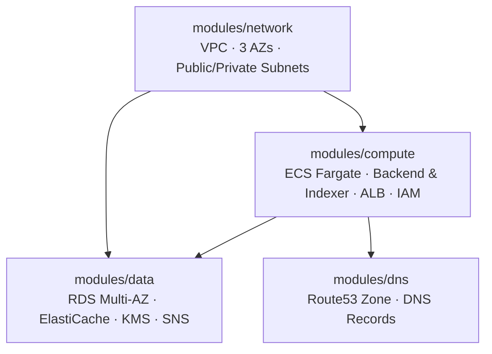

# Terraform — Vesting Cliff Drip Stream

This directory contains the Terraform configuration for provisioning all AWS cloud infrastructure required by the vesting application (ECS, RDS, VPC, IAM, DNS, Secrets, and Remote State).

## Architecture

```
                    ┌─────────────────────────────┐
                    │     Route53 (DNS)           │
                    │  api.vesting.example.com    │
                    └──────────┬──────────────────┘
                               │
                    ┌──────────▼──────────────────┐
                    │   ALB (Application LB)      │
                    │   (Public Subnets - 3 AZs)  │
                    └──────────┬──────────────────┘
                               │ (Port 8080 only)
              ┌────────────────┴────────────────┐
              │                                 │
    ┌─────────▼──────┐                   ┌──────▼─────────┐
    │  ECS Fargate   │                   │  ECS Fargate   │
    │  Backend API   │                   │  Event Indexer │
    │ (Private Sub.) │                   │ (Private Sub.) │
    └─────────┬──────┘                   └──────┬─────────┘
              │                                 │
              └────────────────┬────────────────┘
                               │ (Port 5432 only)
                    ┌──────────▼──────────────────┐
                    │  RDS PostgreSQL 15          │
                    │  (Private Subnets - 3 AZs)  │
                    │  (Multi-AZ in Production)   │
                    └─────────────────────────────┘
```

## Module Dependency Diagram



- `network` provisions the 3 AZ network foundation (VPC, public/private subnets, NAT gateways).
- `compute` provisions ECS Fargate cluster, task definitions for backend API and event indexer, ALB, and security groups.
- `data` consumes security group IDs from `compute` so PostgreSQL RDS port 5432 is accessible from ECS tasks only.
- `dns` connects the ALB endpoint to Route53 domain alias records.

---

## Infrastructure Modules

| Module | Description | Core Resources |
|---|---|---|
| [`network`](modules/network/README.md) | VPC spanning **3 Availability Zones**, public and private subnets, NAT gateways, route tables, S3 gateway endpoint | `aws_vpc`, `aws_subnet` (3 public, 3 private), `aws_nat_gateway`, `aws_route_table` |
| [`compute`](modules/compute/README.md) | ECS Fargate cluster, task definitions for **backend API** and **event indexer**, ALB, CodeDeploy, ECS IAM task roles | `aws_ecs_cluster`, `aws_ecs_task_definition` (backend, indexer), `aws_ecs_service`, `aws_lb`, `aws_security_group` |
| [`data`](modules/data/README.md) | **RDS PostgreSQL 15** in private subnets (**Multi-AZ** for production), ElastiCache Redis, customer KMS key, SNS alerts | `aws_db_instance` (Postgres 15, Multi-AZ), `aws_security_group` (RDS), `aws_kms_key` |
| [`dns`](modules/dns/README.md) | Route53 hosted zone, alias A records pointing to ALB | `aws_route53_zone`, `aws_route53_record` |
| `secrets` | AWS Secrets Manager secrets, automated password rotation Lambda | `aws_secretsmanager_secret`, `aws_lambda_function` |

---

## Security & Network Isolation

### Security Groups
- **ALB Security Group (`${env}-alb-sg`):** Accepts HTTP (port 80) and HTTPS (port 443) from the public internet (`0.0.0.0/0`).
- **Backend API Security Group (`${env}-ecs-backend-sg`):** Inbound traffic on container port (`8080`) is allowed **only from the ALB security group**. No direct internet ingress.
- **RDS Security Group (`${env}-rds-sg`):** Inbound traffic on PostgreSQL port (`5432`) is allowed **only from ECS tasks** (`backend` and `indexer`). No direct external or public access.

### IAM Roles & Least Privilege
- **ECS Task Execution Role (`${env}-ecs-exec`):** Pulls images from ECR, retrieves Secrets Manager parameters, and creates CloudWatch log streams.
- **ECS Task Role (`${env}-ecs-task`):** Grants the application container permissions to query Secrets Manager, connect to RDS via IAM authentication, read/write S3 bucket objects, and publish CloudWatch logs/metrics.
- **GitHub Actions OIDC Role (`${env}-github-actions-deploy`):** Authenticates CI/CD pipelines via OpenID Connect (OIDC). **Eliminates static AWS access keys** from GitHub repository secrets.

### Resource Tagging
All resources inherit standardized tags via the AWS provider `default_tags`:
```hcl
default_tags {
  tags = {
    Project     = "vesting-drips"
    Application = "vesting-cliff-drip-stream"
    Environment = var.environment
    ManagedBy   = "terraform"
    Repository  = "Praisefotos1/vesting-cliff-drip-stream"
  }
}
```

---

## Environments & Remote State

State lives in a per-environment S3 bucket with DynamoDB state locking, AES-256 SSE encryption, bucket versioning, public access blocked, and MFA delete enabled.

| Environment | State Bucket | State Key | Lock Table | Backend Config | Variables File |
|---|---|---|---|---|---|
| **staging** | `vestingdrips-terraform-state-staging` | `staging/terraform.tfstate` | `vestingdrips-terraform-locks-staging` | `envs/staging.backend.hcl` | `envs/staging.tfvars` |
| **production** | `vestingdrips-terraform-state-production` | `production/terraform.tfstate` | `vestingdrips-terraform-locks-production` | `envs/production.backend.hcl` | `envs/production.tfvars` |

### Bootstrap Remote State (First-Time Setup)

To resolve the chicken-and-egg problem of creating the remote backend before Terraform can use it, run the automated bootstrap script:

```bash
# First-time bootstrap for staging
./scripts/terraform-bootstrap.sh staging --init-backend

# First-time bootstrap for production
./scripts/terraform-bootstrap.sh production --init-backend

# Or bootstrap both at once
./scripts/terraform-bootstrap.sh all --auto-approve --init-backend
```

For full bootstrap details, stale-lock resolution, and disaster recovery procedures, consult the [Terraform Bootstrap Runbook](../docs/runbooks/terraform-bootstrap.md).

---

## Usage

### 1. Initialize Backend
```bash
# Staging
export TF_DATA_DIR="$PWD/.terraform/staging"
terraform init -input=false -backend-config=envs/staging.backend.hcl

# Production
export TF_DATA_DIR="$PWD/.terraform/production"
terraform init -input=false -backend-config=envs/production.backend.hcl
```

### 2. Plan Infrastructure
```bash
# Staging
export TF_DATA_DIR="$PWD/.terraform/staging"
terraform plan -lock-timeout=5m -var-file=envs/staging.tfvars

# Production
export TF_DATA_DIR="$PWD/.terraform/production"
terraform plan -lock-timeout=5m -var-file=envs/production.tfvars
```

### 3. Apply Changes
```bash
# Staging
export TF_DATA_DIR="$PWD/.terraform/staging"
terraform apply -lock-timeout=5m -var-file=envs/staging.tfvars

# Production (requires team approval)
export TF_DATA_DIR="$PWD/.terraform/production"
terraform apply -lock-timeout=5m -var-file=envs/production.tfvars
```

---

## Estimated Monthly Cost

| Service | Configuration | Staging | Production |
|---|---|---|---|
| ECS Fargate | backend 256 CPU / 512 MB | ~$10 | ~$35 (Multi-AZ) |
| ECS Fargate Spot | indexer 256 CPU / 512 MB | ~$4 | ~$12 |
| ALB | 1 LB (3 AZs) | ~$22 | ~$22 |
| RDS PostgreSQL 15 | db.t3.micro (stg) / db.t3.small (prod Multi-AZ) | ~$17 | ~$70 |
| ElastiCache Redis | cache.t3.micro, 1 node | ~$14 | ~$28 |
| NAT Gateways | 3 AZs | ~$96 | ~$96 |
| Route53 & S3 | DNS zone + State storage | ~$3 | ~$4 |
| **Total** | | **~$166/mo** | **~$267/mo** |
